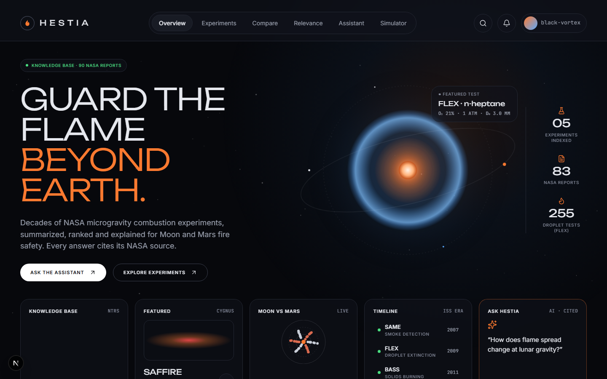
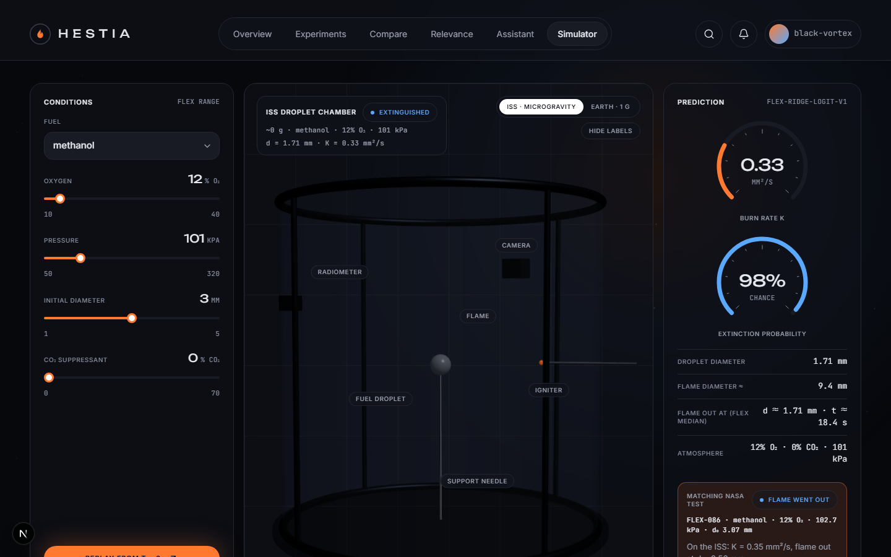
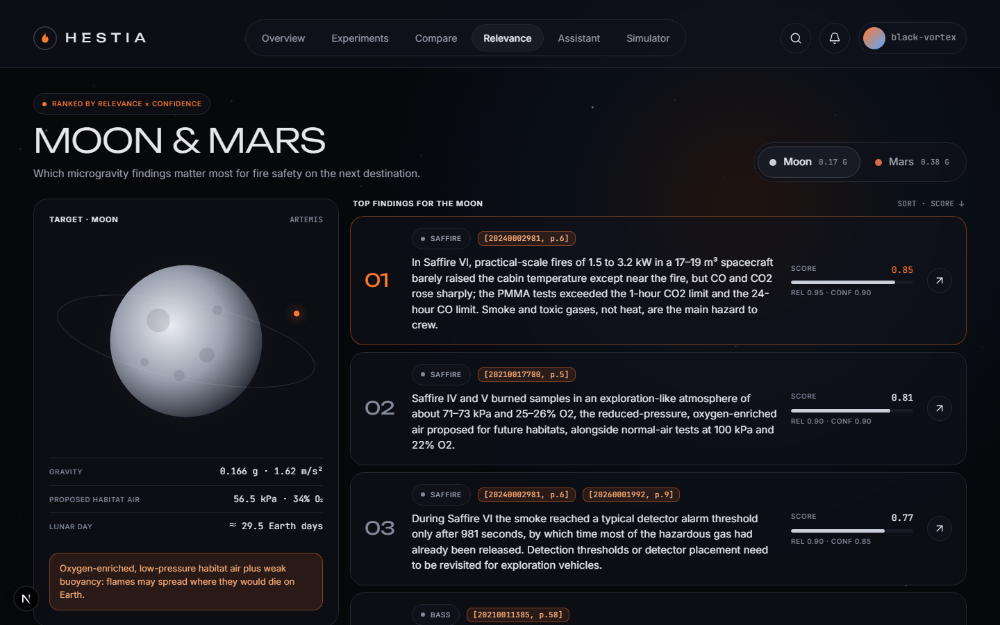
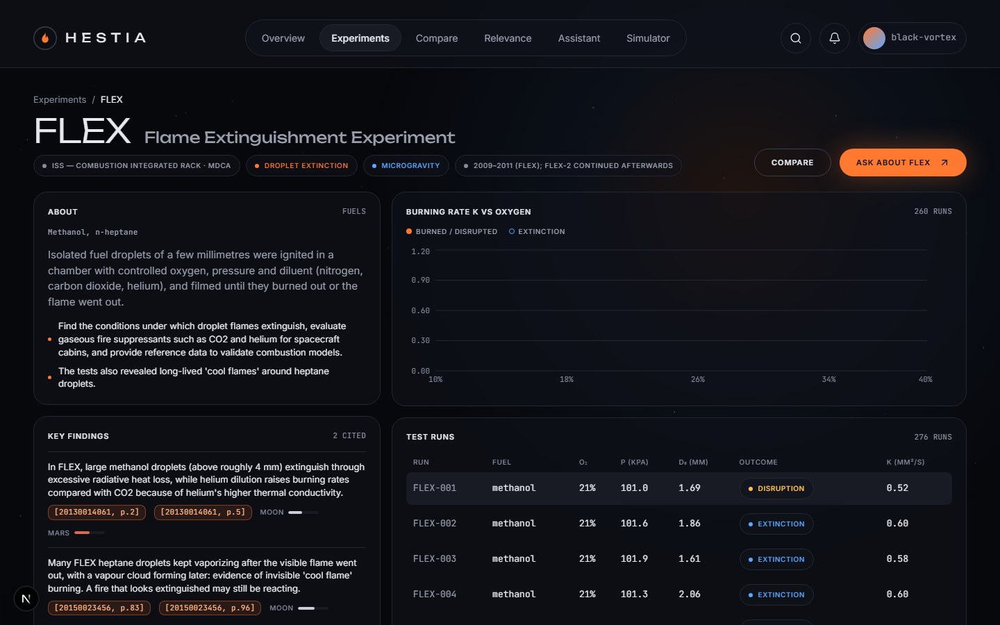

<p align="center">
  
</p>

<h1 align="center">Hestia</h1>

<p align="center"><b>Guarding the flame beyond Earth.</b><br>
AI-powered fire-safety insights from NASA microgravity combustion data, for the Moon and Mars.</p>

<p align="center">
  
  
  
  
  
</p>

<p align="center">
  <a href="docs/Hestia_slides.pdf"><b>Slides (PDF)</b></a> ·
  <a href="#features">Features</a> ·
  <a href="#quick-start">Quick start</a> ·
  <a href="#nasa-data">NASA data</a> ·
  <a href="#team">Team</a>
</p>



NASA has spent decades burning things in microgravity: droplets on the ISS (FLEX), solids (BASS,
BASS-II), full-size fabrics on cargo ships (Saffire) and smoke in gloveboxes (SAME). The answers
exist, but they are scattered across hundreds of reports and data tables. **Hestia turns that
research into answers**: every AI answer is grounded in NASA sources and cites the exact page
(`[NTRS-ID, p.X]`), and when the sources don't cover a question, Hestia says so.

Built by **black-vortex** (Douala, Cameroon) for the NASA Space Apps Challenge 2026,
challenge *Flame in Freefall: AI-Powered Fire Safety Insights from Microgravity Combustion Data*.
Hestia is named after the Greek goddess of the hearth, who kept the home fire under control.

## Features

| | |
|---|---|
| **Ask** | A RAG assistant answering in English or French from 55 NTRS reports, 24 PSI investigations and NASA resources. Every claim links to the PDF page it came from. |
| **Explore** | Experiment pages for FLEX, BASS, BASS-II, SAME and Saffire with 544 test runs, curated findings with verified citations, side-by-side comparison. |
| **Relevance** | Findings ranked by relevance × confidence for the Moon or for Mars. |
| **Simulate** | A 3D combustion chamber driven by a model trained on 276 ISS droplet tests, with the closest real NASA test and an extrapolation warning. Earth (1 g) vs ISS view. |
| **Search** | A Ctrl/⌘ K palette over experiments, findings, report passages and test runs, working even without the AI. |

<table>
  <tr>
    <td width="50%"><br><sub><b>Simulator:</b> methanol at 12 % O₂ goes out at 2.52 mm predicted; the real ISS test FLEX-086 went out at 2.56 mm.</sub></td>
    <td width="50%"><br><sub><b>Relevance:</b> findings ranked for the Moon or Mars, each with its NASA page citation.</sub></td>
  </tr>
  <tr>
    <td colspan="2"><br><sub><b>Explore:</b> the FLEX experiment page with cited findings and every test run from the PSI tables.</sub></td>
  </tr>
</table>

### RAG module

`/ask` retrieves passages from PostgreSQL/pgvector (NTRS reports, PSI investigations, NASA resources), has the LLM answer from numbered passages and returns citations rebuilt and verified by the backend. Documentation, ingestion commands and test status: **[docs/RAG.md](docs/RAG.md)**. First thing to run with real keys: `make check-llm`.

## Architecture

```
  NTRS API ──► pipeline/fetch_ntrs ──► data/ntrs/pdf ──► pipeline/extract_text ──► data/ntrs/text
  PSI (manual) ─► data/psi                                      │
  FLEX Table IX ─► data/flex/*.csv                              ▼
                                       pipeline/chunk ─► pipeline/embed ─► pipeline/ingest
                                                                                │
                                                                                ▼
 ┌──────────────────────┐   HTTP/JSON   ┌──────────────────────────┐   SQL   ┌─────────────────────┐
 │ web/  Next.js (3000) │ ────────────► │ backend/ FastAPI (8000)  │ ──────► │ PostgreSQL 16       │
 │ Tailwind · Recharts  │ ◄──────────── │ routers · services/llm   │         │ + pgvector (5434)   │
 │ React Three Fiber    │  typed via    │ services/retrieval       │         │ docker compose      │
 └──────────────────────┘  OpenAPI      └────────────┬─────────────┘         └─────────────────────┘
                                                     │ LLM_PROVIDER
                                                     ▼
                                     mock │ openai │ gemini │ anthropic
```

| Layer | Stack |
|---|---|
| Frontend | Next.js (App Router) · TypeScript strict · Tailwind CSS · Recharts · React Three Fiber · pnpm |
| API | Python 3.12 · FastAPI · Pydantic v2 · uv · ruff |
| Database | PostgreSQL 16 + pgvector · SQLAlchemy 2 · Alembic |
| Data | PyMuPDF · pandas · scikit-learn |

## Quick start

Prerequisites: Docker, [uv](https://docs.astral.sh/uv/), Node 24+ with pnpm, and `make`
(on Windows: `winget install ezwinports.make`, then use Git Bash).

```bash
cp .env.example .env    # then set LLM_PROVIDER=gemini and GEMINI_API_KEY
make install           # uv sync + pnpm install
make up migrate        # Postgres + pgvector, tables
make fetch extract     # NTRS catalog + PDFs + per-page text (~10 min)
make ingest            # chunk + embed documents, load experiments, FLEX runs, findings
make api               # terminal 1 → http://localhost:8000/docs
make web               # terminal 2 → http://localhost:3000
```

Everything also runs with `LLM_PROVIDER=mock` and no key: search falls back to keyword
matching and the assistant returns extractive answers. After adding a key, re-embed with
`make ingest ARGS=--force` (embeddings from different providers are not comparable).
`make seed` still inserts placeholder rows if you only want to see the UI.

### Other commands

| Command | What it does |
|---|---|
| `make fetch` | Download the NTRS catalog + PDFs into `data/ntrs/` |
| `make extract` | Per-page text + `extraction_report.csv` |
| `make flex` | Re-parse FLEX Table IX into `data/flex/flex_table_ix.csv` |
| `make ingest` | Load documents (chunk + embed), experiments, findings (`ARGS=--force` re-embeds) |
| `make lint` | ruff + eslint + tsc |
| `make test` | Backend tests |
| `make types` | Regenerate `web/src/lib/api-types.ts` (API must be running) |
| `make down` | Stop Postgres |

## API

| Method | Route | Purpose |
|---|---|---|
| GET | `/health` | `{status, db}` with a real DB check |
| GET | `/stats` | Knowledge-base counts for the overview |
| GET | `/experiments` | List; filters `fuel`, `gravity`, `outcome`, `o2_min`, `o2_max` |
| GET | `/experiments/{code}` | Detail + test runs + findings + sources |
| GET | `/compare?codes=A,B` | Side-by-side comparison |
| GET | `/compare/insights?codes=A,B` | Key differences with verified citations (LLM, cached) |
| GET | `/ranking?target=moon\|mars` | Findings ranked by relevance × confidence |
| POST | `/ask` | `{question, history?}` → `{answer, citations, insufficient_data}` |
| POST | `/predict` | `{fuel, oxygen_percent, pressure_kpa, initial_diameter_mm, co2_percent?, he_percent?}` → `{burn_rate_k, extinction_probability, droplet_lifetime_s, in_training_range}` |
| GET | `/predict/model` | Training size, cross-validated metrics, valid input ranges |

### How answers stay grounded

1. **Hybrid retrieval**: pgvector cosine similarity + Postgres full-text search, merged with
   reciprocal rank fusion. Chunks never cross a page, so every passage has an exact page.
2. **Generation**: the LLM sees only the retrieved passages and must cite `[NTRS-ID, p.X]`.
3. **Verification**: every citation is checked against the retrieved (document, page) pairs;
   anything else is removed. No relevant passage, or no surviving citation, means
   `insufficient_data: true`.

### The FLEX model

Trained at startup on `data/flex/flex_table_ix.csv`: ridge regression for the burning-rate
constant K (5-fold CV R² ≈ 0.70, MAE ≈ 0.05 mm²/s) and a degree-2 logistic regression for
extinction vs. complete burn (CV AUC ≈ 0.89). Inputs outside the tested ranges are flagged as
extrapolation. It describes ISS microgravity only.

## Repository layout

```
backend/   FastAPI app (app/), Alembic migrations, data pipeline (pipeline/), tests
web/       Next.js app: one route per screen, src/lib/api.ts typed client
data/      Datasets. See data/README.md for how to obtain each one
```

## Team

**black-vortex** · Douala, Cameroon

| Member | GitHub |
|---|---|
| Frédéric Armel Petnou Honlue (team owner) | [@HonluePetnou](https://github.com/HonluePetnou) |
| Merveilles Fohom | [@Mervy21](https://github.com/Mervy21) |
| Jacques Eyoum | |
| Gustave Cyriac Mekounde Elame | |
| Ismaïla Mohammed El Bachir | |
| Damien Anthony Nkamoloum Tene | |

## Use of AI

- **In the product:** Google Gemini writes the assistant's answers and the embeddings, always from
  retrieved NASA passages; the backend verifies every citation.
- **In development:** code, tests, documentation and pitch material were drafted with AI coding
  assistance (Claude Code) and reviewed by the team. No NASA logos or mission identifiers were
  generated or modified.

Workflow: `main` is protected; work on `feat/<name>` branches and merge at each milestone.
Conventional commits (`feat:`, `fix:`, `chore:`, `docs:`).

## NASA data

- **NASA Technical Reports Server (NTRS)**: <https://ntrs.nasa.gov> · API docs: <https://ntrs.nasa.gov/api/openapi/>
- **NASA Physical Sciences Informatics (PSI)**: <https://psi.nasa.gov>
- **FLEX detailed results**: NASA/TP-2015-216046, Table IX (manually transcribed)

See [data/README.md](data/README.md) for download and transcription steps.

## License

NASA data is in the public domain (NTRS) or released under CC0 (PSI). Hestia is not endorsed by
NASA. A license for the code is still to be chosen by the team.
